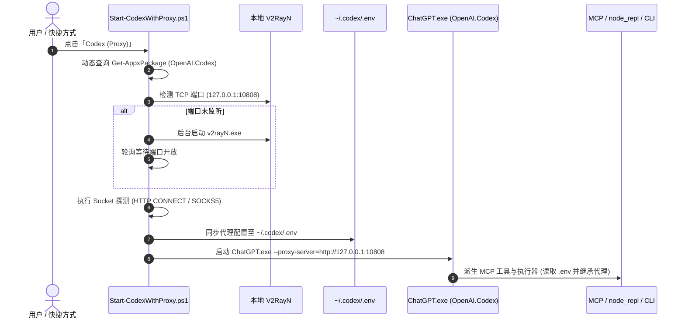

# OpenAI CodeX V2RayN Proxy Suite (`codex-v2rayn-proxy`)

[](https://www.microsoft.com/windows)
[](https://openai.com/)
[](https://github.com/2dust/v2rayN)
[](LICENSE)

专为 **OpenAI CodeX 桌面客户端与 Agent 运行环境** 设计的本地网络代理启动与保障方案。解决 Windows MSIX 自动更新导致快捷方式失效、开启 CodeX 前未开代理导致网络阻塞、以及子进程与 MCP 无法走代理的痛点。

---

## 🌟 核心功能

- **⚡ 动态 MSIX 版本解析（永不失效）**：
  CodeX 采用 Windows MSIX 应用包发布（包名 `OpenAI.Codex`），每次更新后路径均发生变更（例如从 `OpenAI.Codex_26.1029.7803.0_...` 变更为 `OpenAI.Codex_26.1103.4239.0_...`）。传统批处理/快捷方式硬编码路径在升级后会彻底失效。本工具每次启动时**动态解析当前最新安装版本的实际物理路径**（`app\ChatGPT.exe`），无惧任何版本静默自动更新。
- **🚀 启动前自动拉起代理**：
  打开 CodeX 前自动检测本地 V2RayN 是否在运行；若未运行，在后台无感拉起 V2RayN 并轮询确认入站端口就绪，再执行 CodeX 进程。
- **🔌 双层通道注入 + 全生态环境同步**：
  - **CodeX 桌面应用**：注入 Electron / Chromium 参数 `--proxy-server=http://127.0.0.1:10808` 与 `--proxy-bypass-list=<local>;localhost;127.0.0.1;::1`。
  - **环境全域注入**：设置当前进程树的 `HTTP_PROXY`、`HTTPS_PROXY`、`ALL_PROXY` 与 `NO_PROXY`。
  - **持久化同步**：自动将当前有效代理配置同步写入 `~/.codex/.env`，确保 CodeX 内置的 node_repl、CUA 守护进程、Python 沙箱及 MCP Server 全部透明继承代理。
- **🧩 原生 CodeX Skill 支持**：
  完全兼容 OpenAI CodeX Skill 规范（包含 `SKILL.md` 与 `agents/openai.yaml`），安装后自动载入 `~/.codex/skills/v2rayn-proxy`，在 CodeX 内部即可让 AI 自省与排查网络环境。
- **🔄 旧快捷方式智能升级**：
  安装器自动识别用户桌面上已有的旧版失效脚本（如 `Codex-Proxy.lnk` 与 `CodeX_Proxy.bat`），直接将其平滑重定向至全新的动态启动器，开箱即用。

---

## 📐 架构与启动时序图



---

## 📂 项目结构

```text
codex-v2rayn-proxy/
├── .codex-plugin/
│   └── plugin.json                # CodeX 插件市场清单定义
├── .gitignore                     # Git 忽略规则
├── LICENSE                        # MIT 开源协议
├── README.md                      # 项目主说明文档
├── ARCHITECTURE.md                # 架构设计与底层实现细节
├── plugin.json                    # 通用插件元数据清单
├── install.ps1                    # 一键安装脚本
├── assets/
│   └── logo.svg                   # CodeX 风格专属矢量图标
├── skills/
│   └── v2rayn-proxy/
│       ├── SKILL.md               # CodeX 技能主说明与行为指引
│       ├── agents/
│       │   └── openai.yaml        # CodeX Agent 界面元数据与调用策略
│       └── references/
│           └── configuration.md   # 配置项详细参数文档
└── scripts/
    ├── lib/
    │   └── ProxyCommon.ps1        # 共享辅助库（MSIX 解析、端口探测、.env 同步）
    ├── Start-CodexWithProxy.ps1   # 代理启动器（核心）
    ├── Install-Launcher.ps1       # 快捷方式管理脚本
    ├── proxy-status.ps1           # 代理状态与健康诊断工具
    └── proxy-config.ps1           # 配置文件 CLI 管理工具
```

---

## 🚀 快速开始

### 前提条件
- 操作系统：Windows 10 / 11 (x64)
- 已安装 **OpenAI CodeX** Windows 桌面版
- 已安装 **V2RayN**（6.x 或 7.x 均可）

### 一键安装

在当前目录下打开 PowerShell，执行：

```powershell
# 1. 基础安装：安装 Skill 至 ~/.codex/skills/，并创建桌面/开始菜单快捷方式
powershell -ExecutionPolicy Bypass -File .\install.ps1

# 2. 高级选项（开机自启）：在开机登录时自动先起 V2RayN，再启动 CodeX
powershell -ExecutionPolicy Bypass -File .\install.ps1 -Startup

# 3. 高级选项（替换原快捷方式）：将原有的 CodeX 默认快捷方式也重定向至代理启动（自动备份原快捷方式）
powershell -ExecutionPolicy Bypass -File .\install.ps1 -ReplaceOriginal
```

安装完成后：
1. 退出已在运行的 CodeX 窗口（若有）；
2. 双击桌面上的 **「Codex (Proxy)」** 启动。

---

## 🛠️ CLI 常用命令

所有脚本位于 `scripts/` 目录：

```powershell
$s = ".\scripts"

# 1. 查看状态：CodeX 安装路径、V2RayN 运行状态、入站端口、.env 状态
& "$s\proxy-status.ps1"

# 2. 真实发起端到端外部连通性测试
& "$s\proxy-status.ps1" -Online

# 3. 查看当前配置
& "$s\proxy-config.ps1"

# 4. 手动修改配置示例：
& "$s\proxy-config.ps1" -Set proxyPort=10809              # 指定固定端口
& "$s\proxy-config.ps1" -Set verifyBeforeLaunch=true      # 启动前必须通过 Google 连通性测试
& "$s\proxy-config.ps1" -Set syncCodexEnv=false           # 禁止自动写入 ~/.codex/.env
```

---

## ⚙️ 配置说明 (`settings.json`)

配置文件位于 `%LOCALAPPDATA%\CodexProxy\settings.json`：

| 参数名 | 默认值 | 可选值 | 说明 |
| :--- | :--- | :--- | :--- |
| `codexPath` | `""` | 路径 | 为空时自动使用 `Get-AppxPackage` 动态查询当前最新版本 |
| `v2rayNPath` | `""` | 路径 | 为空时自动搜索各盘符及运行中进程 |
| `proxyHost` | `"127.0.0.1"` | IP / 域名 | 代理服务器监听地址 |
| `proxyPort` | `0` | 端口数值 | `0` 表示自动读取 V2RayN 的 `guiNConfig.json` |
| `proxyScheme` | `"auto"` | `auto` / `http` / `socks5` | 代理协议类型 |
| `autoStartV2rayN` | `true` | `true` / `false` | 端口未开启时是否自动启动 V2RayN |
| `waitTimeoutSec` | `30` | 整数 (秒) | 等待 V2RayN 内核就绪的最大超时时间 |
| `onProxyFailure` | `"ask"` | `ask` / `continue` / `abort` | 代理离线时的处理方式 |
| `verifyBeforeLaunch` | `false` | `true` / `false` | 启动前是否必须发起真实的 HTTPS 网络测试 |
| `verifyUrl` | `"https://www.google.com/generate_204"` | URL | 启动前连通性测试目标地址 |
| `noProxy` | `"localhost,127.0.0.1,::1,.local"` | 字符串 | 豁免代理的本地主机地址 |
| `setElectronFlags` | `true` | `true` / `false` | 是否注入 Chromium 的 `--proxy-server` 参数 |
| `syncCodexEnv` | `true` | `true` / `false` | 是否自动同步环境变量至 `~/.codex/.env` |

---

## 🔍 排查与 FAQ

### Q1: CodeX 升级后，原先的桌面快捷方式还能用吗？
> **解答**：完全可以。本启动器每次启动都会动态检测 Windows 注册的 `OpenAI.Codex` 应用包最新目录，彻底告别旧版每次更新后找不到 `ChatGPT.exe` 的问题。

### Q2: 终端命令和 Python 代码能正常走代理吗？
> **解答**：可以。启动器除了为 CodeX 传入参数外，还会将当前代理配置写入 `~/.codex/.env`。CodeX 启动时会自动加载该环境变量文件，其内部执行的 Shell、Python 沙箱与 MCP 工具都会自动继承该代理。

### Q3: 启动器日志在哪里查看？
> **解答**：日志位于 `%LOCALAPPDATA%\CodexProxy\launcher.log`。

---

## 🗑️ 卸载说明

1. 运行快捷方式清理命令：
   ```powershell
   powershell -ExecutionPolicy Bypass -File .\scripts\Install-Launcher.ps1 -Uninstall
   ```
2. 删除 `~/.codex/skills/v2rayn-proxy` 目录即可移除技能。
3. （可选）删除配置缓存：`Remove-Item -Recurse "$env:LOCALAPPDATA\CodexProxy"`。

---

## 📄 开源许可证

本项目基于 [MIT License](LICENSE) 开源发布。
